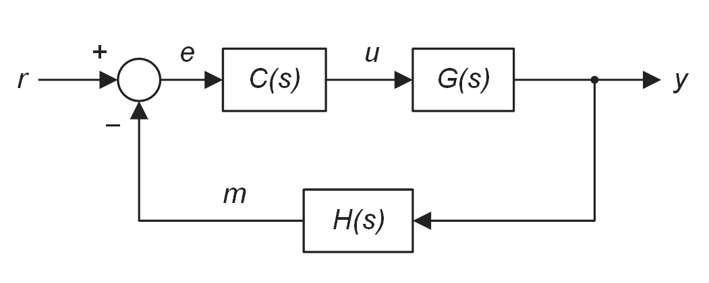

# Visio 文档插图五代

`visio-diagrams-v5` 是一个面向论文和技术文档的 Codex Skill。它将几何关系、坐标约定和标注写入 JSON 场景，生成带原生图层和可编辑图元的 Visio 文件及同版 PNG，便于修改插图并按实际栏宽排版。

- 控制框图按方程区分给定、测量与反馈，支持将原生连接线粘连到模块指定边的中点。可参考[控制图设计](references/control-figures.md)绘制观测器、串级控制、MPC 架构和信号时序。
- 适用于三维坐标系与姿态、六自由度、受力与力矩、流域边界、工程示意和流程图。
- 在同一视图内统一投影实体、坐标轴、力和力矩，支持正交投影、透视投影及隐线处理。修改相机、姿态或载荷后，可从源 JSON 重新生成。
- VSDX 中的线、面、文字、上下标和流程连接线可在 Visio 中编辑。三维几何以投影后的二维图元保存，三维参数保留在源场景中。
- 渲染器导出 VSDX、PNG 和 SVG。配套脚本检查插入宽度下的版面和落盘 VSDX 的图层、形状、文字及连接关系。

## 安装到 Codex

在 Windows PowerShell 中，将仓库克隆到 Codex 的用户技能目录。此方式需要 Git。参见 [Codex 本地技能目录](https://learn.chatgpt.com/docs/build-skills#where-codex-loads-local-skills)。

```powershell
$skillsDir = Join-Path $env:USERPROFILE '.agents/skills'
New-Item -ItemType Directory -Path $skillsDir -Force | Out-Null
git clone https://github.com/aMAoAMa/visio-diagrams-v4.git (Join-Path $skillsDir 'visio-diagrams-v5')
```

在 Codex 中选择 `Visio 文档插图五代` 或调用 `$visio-diagrams-v5`。若技能未显示，重启 Codex。提供相关正文、公式或参考图，并说明插图栏宽和语言。

> 用 `$visio-diagrams-v5` 根据正文里的体固坐标约定绘制船体六自由度示意图。栏宽为 165 mm，标注使用中文，交付可编辑 VSDX、同版 PNG 和源场景。

## 单栏负反馈示例



[可编辑 Visio 样图](examples/feedback-loop.vsdx) · [二维源场景](examples/feedback-loop.json) · [复现命令](examples/guide.md)

## 运行示例

三维投影、场景检查和 VSDX 结构核验使用 Python 3 标准库。Visio 渲染需要 Windows、PowerShell 和支持 `Visio.InvisibleApp` COM 接口的 Microsoft Visio 桌面版。可选的 Word 插图脚本另需 `lxml`、`python-docx` 和 `Pillow`。

在仓库根目录运行下列命令。示例生成地固与体固坐标系、船体六自由度两幅图，结果写入临时目录。将 `6.5` 改为实际插入宽度，单位为英寸。

```powershell
$runDir = Join-Path ([System.IO.Path]::GetTempPath()) ('visio-example-' + [guid]::NewGuid())
New-Item -ItemType Directory -Path $runDir | Out-Null
$scene = Join-Path $runDir 'marine-projected.json'
$figures = Join-Path $runDir 'figures'

python scripts/project_scene3d.py --input examples/marine-3d.json --output "$scene"
python scripts/check_scene.py "$scene" --target-width 6.5
& ./scripts/render_visio.ps1 -ScenePath $scene -OutputDirectory $figures
python scripts/audit_vsdx.py --scene "$scene" --directory "$figures"
```

已有二维场景可直接从 `check_scene.py` 开始，例如 [流域边界侧剖](examples/marine-fluid-domain.json)。导出后按实际插入尺寸查看 PNG，确认标注、隐线和物理方向。修改源场景后同步更新各输出格式。

## 示例与文档

| 内容 | 入口 |
| --- | --- |
| Skill 完整工作流程 | [SKILL.md](SKILL.md) |
| 坐标系、六自由度、流域边界、隐线和流程连接线样例 | [示例指南](examples/guide.md) |
| 三维源场景、相机和投影字段 | [三维场景格式](references/scene3d-format.md) |
| 二维场景、原生图层和导出设置 | [Visio 原生绘制](references/visio-authoring.md) |
| 字号、线型、布局和缩印 | [视觉设计](references/visual-design.md) |
| 保持文档排版并替换指定图位 | [Word 文档集成](references/document-integration.md) |

在没有安装 Visio 的环境中也可以运行几何回归测试。

```powershell
python -m unittest discover -s scripts -p test_geometry.py
```
